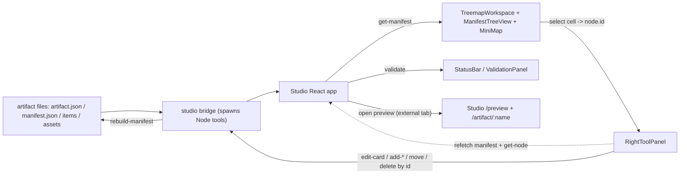

# TreeSite Studio - Front End Plan (Overview)

A thin Vite/React "Studio" editor/deployer UI that pipes the existing TreeSite tooling and artifact files into the mockup layout. This file is the shared context for all phases. Each phase has its own self-contained file (`phase-N-*.md`) intended to be handed to a fresh agent.

Visual reference (not a spec): [spatial_navigation_editor_mockup.html](spatial_navigation_editor_mockup.html) and the PNG in this folder.

## Prime directive / guardrails

- The Studio UI is a **client of the existing editor/handler tooling, not a second implementation of the editor.**
- Prefer **adapters and command wrappers**. Do **not** rewrite operational code (`tools/node/*`, `handler/src/*`, `editor/*`) unless absolutely necessary. If a tiny change to operational code seems required, stop and flag it first.
- Never duplicate artifact state. The UI **reads from artifact files** (via tools) and **writes through tools**. After any mutation, re-fetch from the tools; do not maintain a parallel model of the content.
- Do not invent new artifact concepts or schema fields (e.g. the mockup's `layout`/`card-N` ids are mockup-only and must be ignored). Bind to real `id` / `slug` / `section` / `type`.

## Architecture findings (why this works)

- The operation contract lives in **Node** (`tools/node/*.js`). Each tool reads `--artifact <path>` plus a JSON object on stdin and prints one JSON line: `{"ok":true,"data":...}` or `{"ok":false,"error":{code,message}}`. Shared helpers: [tools/node/tool-runner.js](../../tools/node/tool-runner.js).
- The **Python SDK** ([editor/treesite_editor/tools.py](../../editor/treesite_editor/tools.py)) and **FastAPI API** are both thin adapters that subprocess those same Node tools (see [editor/treesite_editor/runner.py](../../editor/treesite_editor/runner.py)). The Studio bridge is a third thin adapter of the same kind, in Node.
- Artifacts are plain files (see [docs/artifact-spec.md](../artifact-spec.md)): `artifact.json` (meta) + generated `manifest.json` (tree) + `items/<slug>.json` (one per card/section, immutable UUID `id`) + `assets/` + `schemes/`. Example: [artifacts/example/manifest.json](../../artifacts/example/manifest.json).
- View preview is **in-process on Studio port 5175**: `/preview/*` serves built `handler/dist` (via `npm --prefix handler run build:studio-preview`), `/artifact/:name/*` serves artifact files. URL shape: `/preview/?artifact=/artifact/:name/`. See [`docs/studio-preview.md`](../studio-preview.md). Optional detached CLI ([`open-view-preview.js`](../../tools/node/open-view-preview.js)) is not used by Studio MVP. Studio does not embed the handler in an iframe.

## Tool catalog (all included)

Full reference: [docs/tool-catalog.md](../tool-catalog.md). Every tool below is reachable through the generic bridge passthrough (see "Bridge contract").

- Inspect (read-only): `get-node`, `get-children`, `search`, `inspect-subtree`, `artifact-stats`, `get-manifest`, `inspect-tree`.
- Mutate by `id`: `add-card`, `edit-card`, `delete-card`, `rename-card`, `move-card`, `hide-card`, `unhide-card`, `move-subtree`.
- Asset intakes (Node-only): `add-pdf`, `add-website`, `add-html`.
- Lifecycle: `validate`, `rebuild-manifest`, `migrate`, `export-zip`, `import-zip`.

Tool input shapes match [editor/treesite_editor/tools.py](../../editor/treesite_editor/tools.py) (the proven adapter). Notable specifics confirmed in source:
- `edit-card` accepts `{ id, fields: { ... } }` (preferred) - see [tools/node/edit-card.js](../../tools/node/edit-card.js) lines 84-87. Changing `slug` via edit is rejected; use `rename-card`.
- `add-pdf` / `add-html` require a server-resolvable `sourcePath` to a local file - see [tools/node/add-pdf.js](../../tools/node/add-pdf.js). `add-website` requires only `url` (uses Playwright, a handler devDependency, for the preview).
- `delete-card` requires `confirm: true`.

## Integration: the Studio bridge (decided)

A new Vite dev-server middleware (`studio/server/toolBridge.mjs`) invokes the Node tools in-process, mirroring `runner.py`. One `npm run dev` starts everything; no Python runtime and no standalone API server required. The Python SDK and FastAPI API remain available but optional.

### Bridge contract (HTTP, dev middleware, mounted under `/api`)

- `GET /api/artifacts` -> list artifacts: `fs.readdir` the artifacts base (default repo `artifacts/`, mirror `TREESITE_DEFAULT_ARTIFACT`/`config.py`), call `artifact-stats` per dir. Returns `[{name, displayName, schemaVersion, itemCount}]`.
- `GET /api/artifacts/:name/files` -> recursive file listing of the artifact dir (for the File System view).
- `POST /api/tool/:tool` -> body `{ artifactName, input }`. Resolves name -> path, spawns `node tools/node/:tool.js --artifact <path>` with `JSON.stringify(input)` on stdin, returns the tool's `{ok,data|error}` verbatim. **This single endpoint covers every tool** (get-node, edit-card, validate, add-card, ...).
- `POST /api/upload` -> multipart; stages an uploaded file to a temp path; returns `{ tempPath }` for use as `sourcePath` (used by `add-pdf` / `add-html`). Clean up temp files after the tool runs.
- `POST /api/preview/open` -> body `{ artifactName }`. Validates `handler/dist` (studio-preview build) and artifact dir; returns self-contained `{ url: "/preview/?artifact=/artifact/:name/", ... }`. No child processes.
- `POST /api/preview/stop` -> no-op `{ ok: true }`.
- `GET /api/preview/status` -> `{ handlerDistReady }`.

Keep the bridge dumb: it resolves the artifact path, runs the tool, returns the result. No business logic, no schema reimplementation.

## State / memory model

- **Derived from files (re-fetch, never duplicate):** manifest tree, item fields, file list, stats, validation result. Re-fetch after every mutation + `rebuild-manifest`.
- **UI-only (React, in-memory):** `selectedArtifact`, `selectedNodeId`, `activePanel` (fileTree | manifestTree | tools | treemap), `expandedNodeIds`, `viewport` (focusNodeId/zoom/pan), `validationStatus`, `dirty` (unsaved field edits), `inputMode` (keyboard | controller).
- **Persisted (localStorage only, no DB):** last selected artifact, panel layout, expanded nodes, input mode.

## Data flow

### Treemap card -> source mapping (required)

Every treemap cell and tree row is built from a `manifest.json` node, which carries `id` and `slug`. Selection sets `selectedNodeId = node.id`. The inspector loads the item with `get-node(id)`; the on-disk source file is `items/<slug>.json`. All mutations target by `id`. A cell with no `id` (the synthetic root) is not editable.

## Component plan (short)

- `AppShell` - grid layout, focus-zone routing, keyboard manager (mockup conversion).
- `TopCommandBar` - See / Import / Validate / Open Preview / Stop Preview / Edit in Studio / Export (integration).
- `ArtifactExplorer` - File System list + JSON/Manifest tree toggle (integration).
- `ManifestTreeView` - tree from `manifest.json`, selection-synced (integration).
- `TreemapWorkspace` - new lightweight D3 squarified treemap projection + selection (new, small).
- `MiniMap` - abstract D3 overview + viewport rect (new, small).
- `RightToolPanel` - contextual fields + action set for the selected node (integration).
- `StatusBar` / `ValidationPanel` - preview status + validation results (integration).

## Phases (run one fresh agent per phase, in order)

1. `phase-1-app-shell.md` - Scaffold `studio/` + AppShell from the mockup using sample data.
2. `phase-2-bridge-and-readonly.md` - Bridge middleware + read-only Explorer, ManifestTree, Treemap, MiniMap on real data.
3. `phase-3-lifecycle-and-deploy.md` - List/import/validate/export + Deploy(View)/Edit launch + validation surfacing.
4. `phase-4-edit-and-structure.md` - Edit scalar fields + add basic card + rename/move/hide/unhide/delete.
5. `phase-5-asset-intakes.md` - `add-pdf` / `add-website` / `add-html` with the upload bridge.
6. `phase-6-keyboard-joydrive.md` - Focus zones, rings, keyboard intent dispatch, controller-ready reducer.

Dependency note: Phase 2 builds the bridge that Phases 3-5 rely on. Phases run sequentially; each file lists explicit prerequisites and done-when criteria so a fresh agent can start from repo state + the prior phase's output.

## Conventions for phase agents

- Re-read this overview first. Stay within the phase's scope; do not start later phases.
- Touch only files listed in the phase (plus obvious new sibling files). Do not modify operational code; if tempted, flag it instead.
- Validate against `artifacts/example` (and `artifacts/knowalgo` where useful).
- Definition of done = the phase's "Done-when" checklist passes.
