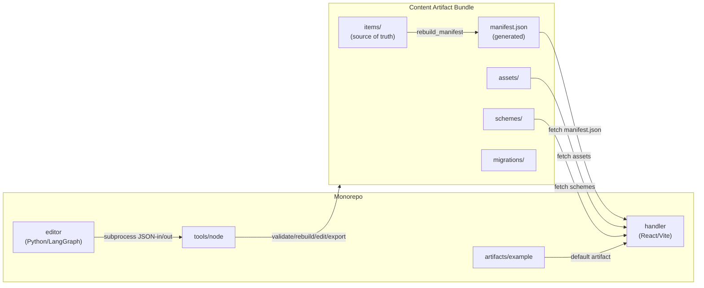

# TreeSite: Handler / Content / Editor Split — Program Overview

**Version:** 1.0  
**Status:** Approved  
**Last updated:** 2026-06-10

---

## Purpose

This document is the master reference for the TreeSite separation program. It defines confirmed architectural decisions, the target system topology, the content artifact specification, the three hard invariants that must hold in every push, the push map, and the cross-cutting conventions that every executing agent must follow.

Each push has its own detailed planning document under `docs/planning/`. Do not begin a push without reading both this overview and the push-specific doc.

---

## Confirmed Architectural Decisions

| Decision | Choice | Rationale |
|---|---|---|
| Repository structure | Monorepo: handler + editor in one repo; content artifacts external | Handler and editor are paired tools; artifacts are independently versioned |
| Runtime content loading | Handler fetches `manifest.json` + `artifact.json` at runtime | Artifacts swap/reload without a Vite rebuild |
| Artifact format | Self-contained directory bundle | Portable, inspectable, versionable; zip deferred to Push 4 |
| Editor implementation | Python/LangGraph orchestrates existing Node scripts as subprocess tools | Minimal rewrite; proven content-editing logic stays in Node |
| Tool interface contract | Named command, JSON in / JSON out, schema validation, structured errors, explicit artifact path, no hidden global state | Stable seam that SDK/API/MCP adapt over without reimplementing logic |
| Node targeting | All mutations addressed by immutable UUID `id` (not slug/path) | Slugs change; IDs never do |
| LLM in the loop | Not by default; deterministic LangGraph; LLM pluggable later | Reproducibility and testability |
| API framework | FastAPI | Standard, OpenAPI-native |
| MCP | Deferred to Push 5; adapter layer only | Build proven tools first |
| Push order | Separation → Tool contract → Python SDK → Hosted API → MCP | Manual editor/viewer workflow prioritized |

---

## Target Monorepo Topology

```
treesite/                         ← git root
  handler/                        ← current treesite-app/src + public, content-agnostic
    src/                          ← React/Vite source (no content references)
    public/                       ← handler-level statics only (no site assets)
    vite.config.js
    package.json
  tools/node/                     ← current scripts/*.js, refactored to JSON-in/out contract
    add-card.js
    edit-card.js
    ...
    content-utils.js
    tool-runner.js                ← shared plumbing: artifact path, JSON in/out, exit codes
  editor/                         ← Python package (Push 3+)
    pyproject.toml
    treesite_editor/
      tools.py                    ← Python subprocess wrappers for each Node tool
      models.py                   ← Pydantic models
      graph.py                    ← LangGraph edit-session graph
      preview.py                  ← local viewer server
  artifacts/
    example/                      ← default generic artifact (ships in repo)
  docs/
    planning/                     ← this folder
      00-overview.md
      01-separation.md
      02-editor-tool-contract.md
      03-python-sdk-langgraph.md
      04-hosted-api.md
      05-mcp-adapter.md
```

### What lives where

| Layer | Location | Notes |
|---|---|---|
| Handler (React/Vite) | `handler/` | Content-agnostic; no KnowAlgo strings |
| Node tool primitives | `tools/node/` | Refactored from `treesite-app/scripts/`; JSON-in/out |
| Python orchestration | `editor/` | Wraps Node tools; LangGraph, API, MCP layers |
| Example artifact | `artifacts/example/` | Ships in repo; default for the handler |
| External artifacts | Outside repo | KnowAlgo and other site bundles |

---

## Content Artifact Bundle Specification

```
<artifact-root>/
  artifact.json       ← artifact metadata (required)
  manifest.json       ← GENERATED hierarchical tree (never hand-edited)
  items/              ← SOURCE OF TRUTH: one JSON file per card/section
  assets/             ← pdfs/  html/  previews/  images/
  schemes/            ← index.json + color scheme files
  migrations/         ← vN_to_vN+1 upgraders
```

### `artifact.json` required fields

```json
{
  "name": "example",
  "schemaVersion": 1,
  "displayName": "TreeSite Example",
  "tagline": "A generic example artifact.",
  "defaultSchemeId": "content-default"
}
```

### Item file (`items/<slug>.json`) required fields

```json
{
  "id": "550e8400-e29b-41d4-a716-446655440000",
  "name": "My Card",
  "slug": "my-card",
  "section": "Home",
  "type": "text"
}
```

`id` is a UUID v4, assigned once, **never changed**.

### `manifest.json`

- Generated by `rebuild_manifest` tool from `items/`.
- The handler fetches this at runtime; it is the only file the handler reads for tree structure.
- **Never edit directly.** Any out-of-sync state between `items/` and `manifest.json` is a validation error.

### Asset references

All asset paths in item JSON are **artifact-relative** (e.g. `assets/pdfs/report.pdf`). The handler prepends the active artifact base URL when resolving them.

### `schemes/index.json`

Mirrors the current `public/color-schemes/index.json` format. The handler fetches this from the artifact base.

### `migrations/`

Upgrader scripts named `v1_to_v2.py`, `v2_to_v3.py`, etc. The `migrate` tool runs them in sequence to bring an artifact from its current `schemaVersion` to the current version.

---

## Three Hard Invariants

These hold in every push, every tool, every surface. Violating any one of them creates debt that is expensive to fix later.

### 1. Immutable IDs

Every item, card, and section carries a permanent UUID `id` field. This `id`:

- Is assigned once, at item creation or (for legacy items) at export time.
- **Never changes** due to rename, move, re-parent, export, import, or schema migration.
- Is the stable reference for editor sessions, deep links, API endpoints, MCP tool calls, and future agents.
- Is preserved verbatim through every round-trip (export → zip → import → edit → export again).

`slug` is a human-readable identifier that **may change**. `id` is the machine identifier that **never changes**.

**Enforcement:** JSON schema `required: ["id"]`; `validate` tool asserts uniqueness across all items in the artifact; mutation tools read target by `id` and write `id` unchanged; export tool back-fills UUIDs for legacy items that lack one, then freezes them.

### 2. `manifest.json` is Derived, Never Authoritative

`items/` is the single source of truth for tree structure. `manifest.json` is a generated artifact produced by running `rebuild_manifest` over `items/`.

- No tool, script, editor, or human ever edits `manifest.json` directly.
- Any tool that writes any file in `items/` **also** calls `rebuild_manifest` before returning.
- `validate` computes the expected manifest from `items/` and flags any difference as an error.

This makes the invariant testable: the output of `rebuild_manifest` on a valid artifact is always identical to its `manifest.json`.

### 3. Schema is Versioned and Upgradeable

`artifact.json` requires a `schemaVersion` integer. The current version at the start of Push 1 is `1`.

- The handler **refuses to load** an artifact with an unknown future `schemaVersion` (returns a clear error message, does not silently corrupt).
- The handler **prompts migration** when `schemaVersion` is below the current known version; it does not load stale artifacts automatically.
- The `migrate` tool runs `migrations/vN_to_vN+1` upgraders in sequence, incrementing `schemaVersion` after each step.
- New `schemaVersion` values are introduced by adding a migration script, never by a silent data change.

---

## Data Flow Diagram



---

## Push Map

| Push | Doc | Focus | Artifact format |
|---|---|---|---|
| 1 | `01-separation.md` | Artifact spec, handler runtime loader, KnowAlgo export, example artifact, repo reorg | directory |
| 2 | `02-editor-tool-contract.md` | JSON-in/out Node tool contract, inspection tools first, ID-addressed mutations, validate/rebuild/migrate | directory |
| 3 | `03-python-sdk-langgraph.md` | Python package, Pydantic models, LangGraph graph, local viewer | directory |
| 4 | `04-hosted-api.md` | Zip packaging, FastAPI, read-only endpoints first, editing endpoints | directory + zip |
| 5 | `05-mcp-adapter.md` | MCP adapter over SDK tools | directory + zip |

---

## Operation Catalog (full reference)

### Read-only inspection (built first in every layer)

| Operation | Description |
|---|---|
| `get_node` | Return full item data for a given `id` |
| `get_children` | Return immediate children of a node by parent `id` |
| `search` | Full-text search across name, description, html, slug |
| `inspect_subtree` | Return full sub-tree rooted at a given `id` |
| `artifact_stats` | Return counts, schemaVersion, item types, asset sizes |
| `get_manifest` | Return the full generated hierarchy |
| `inspect_tree` | Human-readable tree print (existing `inspect-tree.js` behavior) |

### Mutations

| Operation | Description |
|---|---|
| `add_card` | Create a new item (assigns UUID `id`) |
| `edit_card` | Update fields on an item by `id` |
| `delete_card` | Remove an item by `id` |
| `rename_card` | Update `name` and `slug` of an item by `id`; `id` unchanged |
| `move_card` | Change `section` path of an item by `id`; `id` unchanged |
| `hide_card` / `unhide_card` | Set `hidden` flag by `id` |
| `move_subtree` | Re-parent a section subtree by `id` |
| `add_pdf` | Intake a PDF, copy to `assets/pdfs/`, create preview, write item |
| `add_website` | Playwright screenshot, write item |
| `add_html` | Copy HTML bundle, write item |

### Lifecycle

| Operation | Description |
|---|---|
| `validate` | Schema-check all items, assert unique IDs, flag manifest drift |
| `rebuild_manifest` | Regenerate `manifest.json` from `items/` |
| `migrate` | Run `migrations/` upgraders to current `schemaVersion` |
| `export_dir` | Write artifact as a clean directory bundle |
| `import_dir` | Load a directory bundle (validate on import) |
| `export_zip` | Zip a directory bundle (Push 4+) |
| `import_zip` | Unzip and validate (Push 4+) |

---

## Cross-Cutting Conventions

These apply to every push. Every executing agent should treat these as non-negotiable.

1. **Commit per phase; never push to main.** Each numbered phase in a push doc gets its own git commit.
2. **Three hard invariants hold everywhere.** Immutable `id`, derived `manifest.json`, versioned `schemaVersion`. No exception.
3. **Nodes are targeted by `id`, not slug/path.** Every mutation tool, API endpoint, and MCP tool takes `id` as the primary target key.
4. **Build read-only inspection before mutations.** In every layer (tools, SDK, API), implement all read-only operations before any mutation operations.
5. **Artifacts are directories in Pushes 1–3.** Zip packaging arrives in Push 4 and must not be assumed earlier.
6. **Stable tool contracts are the only shared seam.** SDK, API, and MCP layers are thin adapters; they do not reimplement editing logic.
7. **No LLM decisions in the default path.** LangGraph is a deterministic tool-calling graph; LLM nodes are opt-in.
8. **Smoke test at end of every push.** Follow the manual smoke test steps in the push doc before declaring the push complete.
9. **Course-correction report at end of every push.** Fill in the report template and return it to planning mode for review before starting the next push.
10. **No application code is produced by the planning docs themselves.** Planning docs describe *what* to build and *why*, with enough specificity that an agent can execute without ambiguity.

---

## Course-Correction Report Template

Each push doc includes this template. Fill it in at the end of the push and return to planning mode.

```markdown
## Course-Correction Report: Push N — <title>

**Date completed:**  
**Executing agent conversation ID:**

### What was built (vs. plan)
- [ ] Phase 1: ...
- [ ] Phase 2: ...
- [ ] Phase 3: ...
- [ ] Phase 4: ...
- [ ] Phase 5: ...

### Deviations from plan
<!-- List anything that was changed, skipped, or done differently, and why. -->

### Smoke test results
<!-- Pass/fail for each smoke test step with notes. -->

### Hard invariants check
- [ ] Immutable IDs preserved in all tools/surfaces added this push
- [ ] manifest.json derived only, never edited directly
- [ ] schemaVersion checked/used

### Issues / blockers encountered
<!-- Anything that slowed the push or required a workaround. -->

### Recommendations for next push
<!-- Anything the next agent or planning mode should know before starting. -->
```
